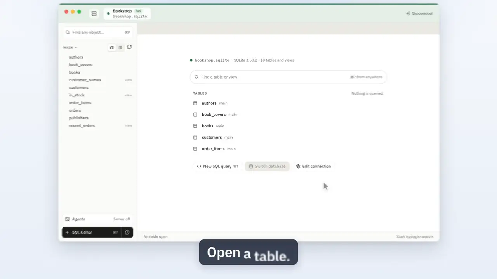
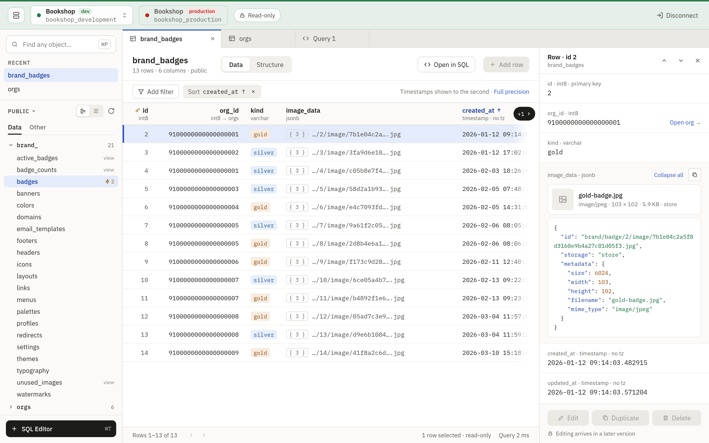
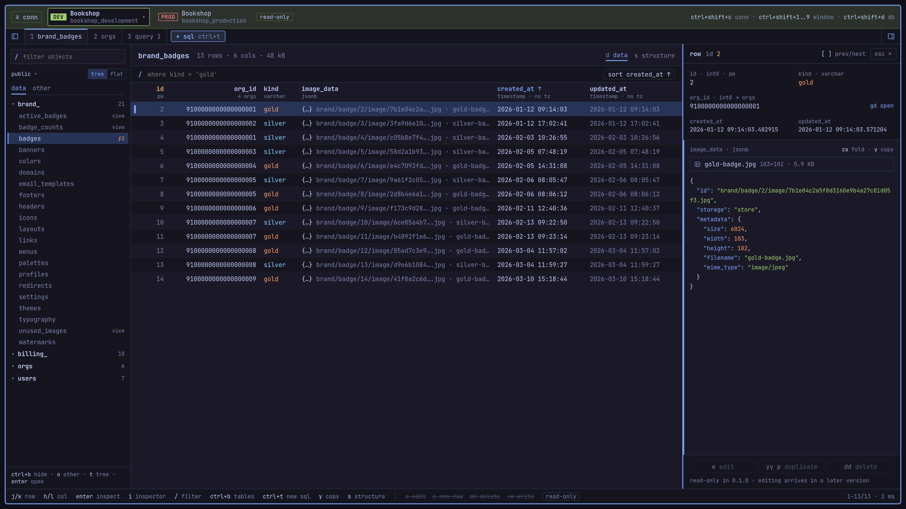

<p align="center">
  
</p>

<h1 align="center">Tabletist</h1>

<p align="center">
  <a href="https://igor.works/tabletist/">igor.works/tabletist</a>
</p>

<p align="center">
  <a href="https://github.com/igor-alexandrov/tabletist/actions/workflows/ci.yml"></a>
  <a href="LICENSE"></a>
  <a href="rust-toolchain.toml"></a>
  
  
</p>

A fast, native database client for **PostgreSQL**, **MySQL**,
**SQLite** and **BigQuery**. Written in Rust with egui; runs on
Linux (Omarchy and Hyprland first), macOS and Windows. BigQuery
connections sign in with a service-account key file or Google Cloud's
default credentials, and open read-only (browse, filter and run SELECTs;
BigQuery has no transactions to edit rows with).

The guide and the reference are on the website:
**[igor.works/tabletist](https://igor.works/tabletist/)**.

<p align="center">
  
</p>

<p align="center">
  
</p>

<p align="center">
  
</p>

## What it does

- Saved connections grouped in a picker, each tagged with its environment
  (dev, staging, production) and when it was last used.
  Open more than one and each is a chip in the window's header: click one
  to switch.
- Direct connections, TLS (libpq's `sslmode` values, with `allow` read as
  `prefer`; `verify-ca` needs a CA file, and MySQL has no `verify-ca` yet),
  and SSH tunnels (password, key file or agent) with host keys trusted on
  first use. The agent is the one `~/.ssh/config` names for the host
  (`IdentityAgent`, as for 1Password), else `SSH_AUTH_SOCK`.
- Passwords live in the system keyring, or are asked for once per
  connection tab (reconnecting in that tab reuses them).
- A connection opens read-only when its "Open read-only" box says so, which
  is the default for production. A writable one opens a read-write session,
  in which browsing, a raw WHERE and a SQL editor switched to Read-only
  still only read.
- On a writable connection a table's values are edited in its grid: changes
  stay pending until Save writes them in one transaction, which never
  overwrites a row someone else changed: a save that finds one writes
  nothing and asks about each such row, with what was loaded, what the
  server holds now and yours side by side (keep mine, use the server's
  values, or overwrite). Before saving, Review SQL shows the statements
  that will run (Cmd/Ctrl+Shift+D, or `:diff` on Omarchy) and
  copies them, and a save to production asks first, with them on screen.
- A sidebar of recent objects and one schema's tables and views, folded into
  prefix groups (`book_`) or listed flat; each table opens with a data grid
  (keys, foreign keys, value tags, JSON at a glance), a row panel showing
  every field in full with a jump along foreign keys, where a value of a
  writable table is edited in place (a click on it, or Cmd/Ctrl+I, Enter on
  Omarchy, to reach the row's fields, and Enter or typing to edit one),
  and a Structure view (columns, indexes, foreign keys).
- Server-side sorting and paging, a filter bar with a raw WHERE option, exact
  counts on demand, and cancel for any running query. MySQL sessions run in
  utf8mb4, with `ANSI_QUOTES`, the combination modes that imply it and
  `NO_BACKSLASH_ESCAPES` turned off: in a raw WHERE `"..."` is a string and
  names take backticks.
- A SQL editor per connection (Cmd/Ctrl+T): run the statement at the cursor
  (Cmd/Ctrl+Return) or the whole script, with a row limit and a timeout, and
  read a result row in full in the row panel.
  On a read-only connection, and on production, every run happens in a
  read-only transaction that is rolled back, and statements that would
  leave it are refused. On a writable connection that is not production's
  a tab opens in Read-write: a run that changes data is one transaction,
  committed when every statement succeeded and rolled back on the first
  error, cancel or timeout, and the Messages say which. A run of reads is
  read-only there too, and the toolbar's switch (or Cmd/Ctrl+Shift+M; `:ro` and `:rw` on Omarchy)
  sets the tab to Read-only and back.
  Format (Cmd/Ctrl+Shift+F; `=` on Omarchy)
  lays queries out in river style and uppercases reserved words, in the
  selection's statements or the whole script. Keywords, schemas, tables,
  views and the columns of a statement's tables are completed while typing
  (Ctrl+Space asks for the list anywhere).
- Cells, a block of them or whole rows are selected in a table's grid and
  in a SQL result, and copied as TSV (Cmd/Ctrl+C, `y` on Omarchy) or, with
  Copy as (Cmd/Ctrl+Alt+C, `gy`), as CSV, JSON, Markdown, SQL INSERT or
  column names. Export (Cmd/Ctrl+Shift+E, `E`) writes a table, a selection
  or a SQL result to CSV, TSV, JSON, JSON Lines, SQL INSERT or Markdown,
  in the background and several at once. Values are written as the
  database holds them, never as the grid formats them.
- Quick open (Cmd/Ctrl+P on macOS and Windows) and a full keyboard map:
  press `?` in the app.
- Looks native on each platform: a macOS look in IBM Plex, and on Linux the
  Omarchy look (square, keyboard first, vim keys, the desktop's monospace
  font throughout). It follows the Omarchy theme live on Omarchy, and the
  system light/dark setting elsewhere.

## Performance

Measured on 2026-11-09 on one Linux machine (AMD Ryzen AI MAX+ 395,
128 GB, NVMe; Omarchy on Hyprland), every app the same way, each from its
first start in an empty profile with a home folder of its own. How each
number was taken, the spreads, the raw reports and the script to take them
again on your machine are in [contrib/measure](contrib/measure/README.md).

### Startup

From launch until the app's window settles on its first screen, the median
of 20 runs. *Cold* is the same with the app's files dropped from the page
cache first.

| App | First screen | Cold |
|---|---|---|
| Tabletist 0.5.0 | 89 ms | 108 ms |
| DB Browser for SQLite 3.13.1 | 135 ms | 168 ms |
| TablePro 0.1.0-beta.3 | 230 ms | 259 ms |
| HeidiSQL 12.22 | 282 ms | 298 ms |
| TablePlus 2.2.0-322 | 432 ms | 465 ms |
| DbGate 7.3.4 | 784 ms | 864 ms |
| DBeaver 26.2.4 | 1,979 ms (a splash at 342 ms) | 2,251 ms |
| Beekeeper Studio 6.2.2 | 2,175 ms | 2,344 ms |
| Valentina Studio 18.4.1 | 3,364 ms (to its registration wizard) | 3,478 ms |

Tabletist's AppImage takes 136 ms; the row above is its unpacked binary.

### Memory at the first screen

The median of three runs. PSS is resident memory with each page that
processes share divided among them, added up over all of an app's
processes. GPU memory is shown beside it: on this integrated GPU it is
system memory too, and an app that draws on the CPU (GPU 0) holds its
pictures in PSS instead.

| App | Processes | PSS | GPU | PSS + GPU |
|---|---|---|---|---|
| DB Browser for SQLite | 1 | 59.4 MiB | 4.8 MiB | 64.2 MiB |
| TablePlus | 8 | 128.7 MiB | 0.0 MiB | 128.7 MiB |
| Tabletist | 1 | 83.4 MiB | 50.6 MiB | 134.0 MiB |
| TablePro | 1 | 111.5 MiB | 32.5 MiB | 144.0 MiB |
| Valentina Studio | 1 | 246.4 MiB | 0.0 MiB | 246.4 MiB |
| HeidiSQL | 1 | 250.4 MiB | 0.0 MiB | 250.4 MiB |
| DBeaver | 8 | 345.0 MiB | 0.0 MiB | 345.0 MiB |
| DbGate | 7 | 395.9 MiB | 98.9 MiB | 494.9 MiB |
| Beekeeper Studio | 7 | 851.1 MiB | 185.3 MiB | 1,036.4 MiB |

### Memory with the same 100,000 rows loaded

The same SQLite table held whole in each app's grid, PSS + GPU, the median
of five runs. The other five apps could not be driven to it with keys on
this machine's locked session; the method README says why for each.

| App | Connected | 100,000 rows loaded | PSS added by the rows |
|---|---|---|---|
| DB Browser for SQLite | 75.7 MiB | 104.0 MiB | 28.3 MiB |
| Tabletist | 150.6 MiB | 161.1 MiB | 15.8 MiB |
| TablePro | 147.2 MiB | 236.4 MiB | 89.1 MiB |
| Beekeeper Studio | 1,029.6 MiB | 1,542.9 MiB | 586.3 MiB |

### Size

x86_64 Linux. The download, and the files it unpacks to.

| App | Download | Installed |
|---|---|---|
| HeidiSQL | 7.3 MB | 17.6 MB |
| Tabletist | 18.6 MB | 45.3 MB |
| TablePro | 35.2 MB | 121.4 MB |
| DB Browser for SQLite | 36.7 MB | 95.2 MB |
| TablePlus | 63.0 MB | 188.4 MB |
| Valentina Studio | 114.4 MB | 447.0 MB |
| DBeaver | 129.1 MB | 216.5 MB |
| DbGate | 216.2 MB | 582.3 MB |
| Beekeeper Studio | 362.4 MB | 1,154.8 MB |

The apps ran unpacked from their release files, each on Wayland or through
XWayland as Omarchy's session starts it (Beekeeper on Wayland, DbGate and
DB Browser's AppImage through XWayland; DB Browser's 100,000 rows with
Arch's package, on Wayland). TablePro for Linux is a beta; DB Browser for
SQLite opens SQLite only.

## Install

- **Arch Linux / Omarchy:** the AUR packages (`tabletist-bin` and
  `tabletist`) are not published yet. Until they are, use the release
  AppImage or `.tar.gz` (see Other Linux below).
- **macOS:** `brew install --cask igor-alexandrov/tabletist/tabletist`, or
  download `tabletist-v<version>-macos-universal.dmg` from the
  [releases](https://github.com/igor-alexandrov/tabletist/releases) and drag
  Tabletist to Applications.
- **Homebrew, from source (macOS and Linux):**
  `brew install igor-alexandrov/tabletist/tabletist`, without `--cask`,
  builds the `tabletist` program from the release's source with Homebrew's
  Rust. It installs no app bundle and no launcher entry: on macOS, the cask
  above is the app.
- **Windows:** run `tabletist-v<version>-x86_64-pc-windows-msvc-setup.exe`
  (or the `aarch64` one on ARM). No administrator rights needed.
- **Other Linux:** to try it, download `tabletist-<version>-x86_64.AppImage`
  (or the `aarch64` one), make it executable and run it. It adds nothing to
  the app launcher. To install it with a launcher entry, take the release
  `.tar.gz`, which holds the binary, a `.desktop` file and the icon, and
  follow the steps on the
  [Download](https://igor.works/tabletist/download/#install-it-the-release-archive) page.

The Linux release binaries are built on Ubuntu 24.04 and need glibc 2.39 or
newer (Ubuntu 24.04, Debian 13, Fedora 40 or later). On an older system,
[build from source](#build-from-source).

## Build from source

Requires the Rust toolchain pinned in `rust-toolchain.toml` (rustup installs
it on the first build). On Linux you also need the Wayland, xkbcommon and GL
development headers.

```bash
cargo build --release
./target/release/tabletist           # or: --demo for a sample database
```

## Omarchy

On Omarchy the app follows the current theme and recolors when you switch
themes. `contrib/omarchy/tabletist.json.tpl` maps an Omarchy theme onto
Tabletist's palette.

## Development

See [AGENTS.md](AGENTS.md) for the test suites (including PostgreSQL, MySQL
and SSH integration tests against `compose.yaml`) and the release process.

## License

MIT, see [LICENSE](LICENSE).
